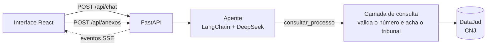

# ⚖️ Agente de Consulta Processual

Quem já precisou saber "em que pé está" um processo sabe como é: abrir o site do tribunal certo, achar o campo de busca, digitar o número inteiro e, no fim, decifrar uma lista de movimentos escrita em juridiquês.

Este projeto encurta esse caminho. Você cola o número do processo (ou anexa a intimação em PDF) e pergunta do jeito que perguntaria a um colega. O agente consulta a **API pública do DataJud**, do CNJ, e devolve a situação em português claro: tribunal, classe, assunto, vara, data de ajuizamento e o que aconteceu por último.

<p>
  
  
  
  
  
  
  
  
  
</p>

## O que dá pra fazer

- **Perguntar em linguagem natural.** "Em que pé está o processo 0000832-35.2018.4.01.3202?" já basta. Se faltar o número, o agente pede. Se a pergunta fugir do assunto, ele avisa que não é com ele.
- **Ver de onde veio a resposta.** Toda consulta ao DataJud aparece na conversa, com um resumo e os dados brutos. Nada de confiar no modelo de olhos fechados.
- **Anexar um PDF.** Intimação, petição, decisão: o sistema extrai o texto, acha os números de processo, confere o dígito verificador de cada um e o agente consulta todos.
- **Acompanhar a resposta sendo escrita.** O texto chega em streaming, e dá pra interromper no meio.
- **Escolher o modelo.** DeepSeek Flash quando a pressa é maior, DeepSeek V4 Pro quando a precisão importa mais.
- **Usar atalhos.** Digite `/` na barra: `/nova` começa outra conversa e `/resumo` resume o que já foi falado.
- **Usar pelo terminal**, se preferir: é o mesmo agente.
- **Trazer a própria chave.** Em "Sua chave", o visitante cola a chave dele do DeepSeek e as perguntas saem da conta dele. Num app público, isso deixa a demonstração de graça pra quem publica.

## Como funciona



Por trás da conversa são quatro peças, cada uma com uma responsabilidade só:

1. **A interface (`web/`)** é um app React. Ela manda a conversa para `/api/chat` e vai desenhando os eventos que chegam: "comecei a consultar", "aqui está o resultado", e os pedaços do texto.
2. **O servidor (`api/`)** é um FastAPI que faz tudo num serviço só: o chat via Server-Sent Events, a leitura dos PDFs, a consulta direta de processos e a entrega da própria interface.
3. **O agente (`agente/`)** é montado com o `create_agent` do LangChain 1.x, com tool calling. É o modelo que decide quando consultar, e a regra é clara: responder só com o que o DataJud devolveu, sem inventar.
4. **A consulta (`consulta/`)** é a parte que não depende de IA nenhuma. Ela valida o número único do processo, inclusive o dígito verificador da Resolução CNJ nº 65/2008, descobre o tribunal pelo próprio número (são 91 tribunais), consulta o DataJud e devolve um resumo enxuto, com os movimentos do mais recente para o mais antigo.

Separar a consulta do agente foi proposital. A validação do número e a busca no DataJud funcionam e são testadas sem modelo nenhum, e a mesma camada atende tanto o agente quanto a rota `/api/processos`.

## Stack

| Camada | Tecnologia | Para quê |
|---|---|---|
| Interface | **React 19 + Vite** | Chat com streaming e a barra de mensagem `PromptBar` |
| Servidor | **FastAPI + Uvicorn** | API, Server-Sent Events e entrega da interface pronta |
| Agente | **LangChain 1.x** | Tool calling: o modelo decide quando consultar o DataJud |
| Modelo | **DeepSeek** | Flash (rápido) ou V4 Pro (preciso), via API compatível com a da OpenAI |
| Dados | **API pública do DataJud (CNJ)** | Metadados de processos de 91 tribunais |
| PDFs | **pypdf** | Extração de texto das intimações e petições |
| Testes | **pytest** | 66 testes, sem chamar nenhum serviço externo |
| Infra | **Docker + Docker Compose** | Uma imagem só, com a interface e o servidor |

## Rodando na sua máquina

Você vai precisar do Docker e de uma chave da API do DeepSeek ([dá pra criar aqui](https://platform.deepseek.com/api_keys)).

```bash
git clone https://github.com/guedesgeorge/Projeto-piloto-para-consulta-de-processos-DataJus.git
cd Projeto-piloto-para-consulta-de-processos-DataJus
cp .env.example .env          # coloque sua chave em LLM_API_KEY
docker compose up -d
```

Depois é só abrir **http://localhost:8000**. Se a porta 8000 já estiver ocupada, coloque `API_PORT=8010` no `.env` e use http://localhost:8010.

Para conversar pelo terminal:

```bash
docker compose run --rm cli
```

### Sem Docker

```bash
python -m venv .venv && source .venv/bin/activate
pip install -r requirements-dev.txt
cp .env.example .env                      # coloque sua chave em LLM_API_KEY
uvicorn api.main:app --reload             # terminal 1: servidor em :8000

cd web && npm install && npm run dev      # terminal 2: interface em :5173
```

### Trocando de modelo

O agente fala com qualquer API compatível com a da OpenAI. Para usar outro provedor, basta trocar três linhas no `.env`:

```bash
LLM_API_KEY=...
LLM_BASE_URL=https://api.openai.com/v1
LLM_MODELOS=gpt-4o-mini,gpt-4o
```

Com o DeepSeek, deixei o modo de raciocínio (*thinking*) desligado. Para consultar e resumir dados, ele só deixaria a resposta mais lenta e mais cara.

## Publicando no Hugging Face

O projeto roda num Space do Hugging Face com o SDK Docker, sem mudar nada no código.

1. Crie o Space em [huggingface.co/new-space](https://huggingface.co/new-space), escolhendo **Docker** como SDK (o template em branco serve).
2. Em **Settings → Variables and secrets** do Space, escolha quem paga pelo modelo:
   - **Cada visitante paga o próprio uso:** não cadastre o `LLM_API_KEY`. A interface pede a chave do DeepSeek de quem for usar, e o Space não gasta nada seu.
   - **Você paga, com limite:** cadastre o `LLM_API_KEY` como *secret* e o `CONFIAR_PROXY=1` como *variable*. Quem quiser passar do limite ainda pode usar a própria chave.
3. Na pasta do projeto, rode:

```bash
./scripts/publicar_hf.sh seu-usuario/nome-do-space
```

O script envia o último commit e troca o README pelo `deploy/huggingface/README.md`, que tem o cabeçalho que o Space exige (`sdk: docker`, `app_port: 8000`). Na primeira vez, o git pede usuário e senha. A senha é um [token do Hugging Face](https://huggingface.co/settings/tokens) com permissão de escrita.

### Limite de uso

Num app público, qualquer visitante conversa usando a sua chave do modelo. Por isso o chat tem três tetos, configuráveis no `.env` ou nas variáveis do Space:

| Variável | Padrão | O que limita |
|---|---|---|
| `LIMITE_IP_HORA` | 20 | Mensagens por visitante por hora |
| `LIMITE_IP_DIA` | 60 | Mensagens por visitante por dia |
| `LIMITE_GLOBAL_DIA` | 150 | Mensagens de todos os visitantes somados, por dia |

Quando um teto estoura, o chat responde com status 429 e avisa quanto tempo falta para liberar. Use `0` para desligar um teto. Os contadores ficam em memória, então zeram quando o servidor reinicia.

### Traga sua chave

O botão **Sua chave**, no topo da página, guarda a chave do DeepSeek do visitante no navegador dele (`localStorage`). A chave vai no cabeçalho `X-LLM-Key` de cada pergunta e o servidor a repassa ao DeepSeek. O servidor não grava essa chave nem a mantém em memória depois da resposta, e as perguntas feitas com ela não contam no limite de uso.

Sem `LLM_API_KEY` no servidor, a chave do visitante passa a ser obrigatória. O `/api/config` informa isso à interface com o campo `chave_servidor`.

## API

A documentação interativa fica em **http://localhost:8000/docs**.

| Rota | O que faz |
|---|---|
| `GET /api/processos/{numero}` | Consulta um processo e devolve o resumo em JSON |
| `POST /api/chat` | Conversa com o agente (streaming via Server-Sent Events). Aceita a chave do visitante no cabeçalho `X-LLM-Key` |
| `POST /api/anexos` | Lê um PDF e devolve o texto e os números de processo válidos |
| `GET /api/config` | Lista os modelos disponíveis e diz se o servidor tem chave própria do LLM |

E os status que `/api/processos` pode devolver:

| Status | Quando |
|---|---|
| 200 | Processo encontrado |
| 400 | Tribunal fora do DataJud (STF e CNJ) |
| 404 | Processo não encontrado ou sob sigilo |
| 422 | Número inválido (tamanho ou dígito verificador) |
| 503 | DataJud fora do ar, lento demais ou com a chave pública desatualizada |

## A barra de mensagem (`PromptBar`)

Acabei gostando tanto da barra de mensagem que a deixei como um componente React independente, sem dependência do resto do projeto. Dá pra levar para outro chat:

```jsx
<PromptBar
  placeholder="Pergunte sobre um processo…"
  sources={[{ key: 'pdf', name: 'Anexar PDF', icon: Pdf01Icon, attach: true, accept: '.pdf' }]}
  commands={[{ key: 'nova', name: '/nova', description: 'Começar uma conversa nova' }]}
  models={[{ key: 'deepseek-flash', name: 'DeepSeek Flash', tag: 'Rápido' }]}
  busy={busy}
  onSend={(texto, { attachments, model, effort, sources }) => enviar(texto)}
  onStop={() => controller.current?.abort()}
  sparkColor="#b39dff"
  maxRows={5}
/>
```

Ela tem menu de anexos no `+`, comandos com `/` (setas para navegar, Tab completa, Esc fecha), seletor de modelo e de esforço, chips para os anexos e um botão de enviar que vira botão de parar enquanto a resposta chega. Cores, tamanho e animações são todos configuráveis por props, e ela respeita o `prefers-reduced-motion` de quem não quer animação.

## Testes

```bash
pip install -r requirements-dev.txt
pytest
```

São 66 testes, e nenhum deles chama serviço externo. Eles cobrem:

- a validação do número CNJ e a identificação do tribunal;
- a consulta, com respostas simuladas do DataJud, incluindo timeout, erro 5xx e chave recusada;
- o agente: quando chama a ferramenta, quando não chama, a ordem dos eventos, o histórico e os anexos;
- o chat em streaming, a escolha do modelo e o que acontece quando o LLM falha;
- a leitura de PDFs;
- o limite de uso do chat e o modo "traga sua chave".

## Estrutura

```
.
├── consulta/
│   ├── numero_cnj.py     # Validação do número CNJ e identificação do tribunal
│   ├── datajud.py        # Cliente da API pública do DataJud
│   ├── servico.py        # Consulta de processo (usada pela API e pelo agente)
│   └── anexos.py         # Leitura de PDFs
├── agente/
│   ├── agente.py         # Agente, ferramenta, modelos e streaming de eventos
│   └── cli.py            # Conversa pelo terminal
├── api/
│   ├── main.py           # Servidor FastAPI (rotas /api e interface web)
│   └── limites.py        # Limite de uso do chat por visitante e por dia
├── web/                  # Interface React (Vite)
│   └── src/
│       ├── App.jsx       # Tela do chat
│       ├── PromptBar.jsx # Barra de mensagem reutilizável
│       └── api.js        # Chamadas ao servidor e leitura do streaming
├── tests/                # Testes (pytest)
├── deploy/huggingface/   # README do Space no Hugging Face
├── scripts/publicar_hf.sh # Publica o projeto no Space
├── Dockerfile            # Monta a interface e o servidor numa imagem só
└── docker-compose.yml
```

## O que ele não faz (e cuidados)

- O DataJud traz só **metadados de processos públicos**. Não vêm os nomes das partes nem o conteúdo das decisões, e processos sob sigilo não aparecem.
- O **texto dos PDFs anexados vai para o modelo de linguagem**. Não anexe nada sigiloso.
- PDF digitalizado como imagem não tem texto para extrair. Quando isso acontece, o sistema avisa.
- O DataJud às vezes demora mais de 40 segundos para responder. O sistema espera até 90 segundos e tenta de novo uma vez.
- A chave de acesso do DataJud é pública, mas o CNJ pode trocá-la. Se aparecer um erro 503 falando da chave, copie a vigente da [wiki do DataJud](https://datajud-wiki.cnj.jus.br/api-publica/acesso) para o `.env`.

---

Feito por **George Emannuel Guedes de Carvalho**, estudante de Ciência da Computação na UCDB, em Campo Grande/MS. Se quiser trocar uma ideia sobre o projeto, me acha em [github.com/guedesgeorge](https://github.com/guedesgeorge) ou no [LinkedIn](https://www.linkedin.com/in/george-guedes).
